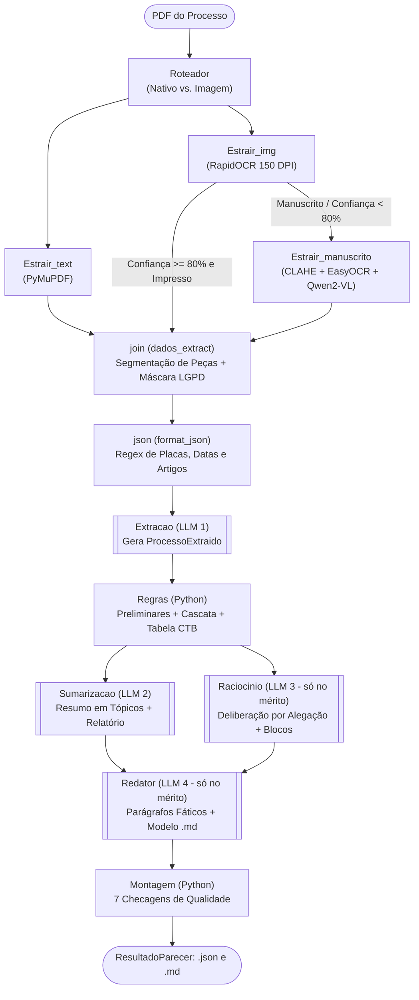

Esse projeto nasceu como emergencia da dor dos porcesso acumulados dos agentes analiticos do departamento de transito. Nesse sentido, foi desenhando para servir de apoio para a descicoes administrativas e de elaboraçao de minutas para as juntas administrativas, atualmente, esta restrigindo a junta de recuro infraçao (JARI) do DETRAN SEDE RN Natal.

Resumo do MVP do sistema agentico analico de processos da CTB apenas na instacia JARI:

O MVP deve provar a viabilidade com um conjunto de:
1. Avaliação com processos já julgados. Sem ele o protótipo roda, mas não responde se o projeto é viável.
2. Funções determinísticas em nós fixos tentando metigar possiveis alucianaçoes do modelo.
	- Vale para:
		para tempestividade, CTB e modelos de parecer.
3. Nó de extração estruturada entre a ingestão e o raciocínio. Ele entrega um JSON compacto em vez do texto integral do processo.
4. devolutiva do modeo:
	- **Resumo Estruturado do Caso (`resumo`):** Identificação do Auto de Infração (AIT), partes, linha do tempo cronológica com indicação de folhas (`fl. N`), alegações sintetizadas, pedido, peças juntadas e pontos de atenção.
	- **Minuta Oficial do Parecer (`minuta_parecer`):** Parecer completo estruturado em: 
		**1. BREVE RELATÓRIO**, 
		**2. FUNDAMENTAÇÃO JURÍDICA** e 
		**3. CONCLUSÃO**, combinando regras determinísticas em Python:
			 (admissibilidade pela Resolução CONTRAN nº 900/2022) e análise de mérito por alegação com blocos de tese oficiais da JARI.

## Caracteristicas: 

#### Extração:
Extração nativa vetorial (`PyMuPDF`) para páginas digitais (texto explicito)
Extração via OCR (RapidOCR) para imagnes com letra de computador e para textos manuscritos foi implentado uma extração em cascata 
	1. RapidOCR usando um realce morfologico (OpenCV) [funciona bem para imagens com boa qualidade ou quer foram digitalizadas com letra de computador] => confiança maior que 80% é passado para o no de formatação de texto caso menor é passa por mais um processo de OCR
	2. EasyOCR (PT): usando fallback de caligrafia ([Surya OCR](https://github.com/VikParuchuri/surya): Uma alternativa mais moderna que já faz a detecção de texto e a análise de layout complexo simultaneamente que nao foi aplicado no momento para agilizar o processo e validaçõa do MVP) 
	3. Qwen2-VL-2B-Instruct7 (VLM local em CPU): para transcrição de manuscritos de baixa legibilidade o processo mais custoso no momento que so é chamado como ulitma alternativa para extração documental.
	Todo esse processo em cascata é mesclado acada etapa mantendo as partes com maior confiança durante esse processo. atravez de:
		- **Julgamento Determinístico de Preliminares:** Tempestividade, assinatura, legitimidade, pedido e regularidade de procuração (Portaria nº 029/2018-GADIR) são verificadas em Python sem custo de LLM.
		- **Montagem Guiada por Blocos Oficiais:** O LLM nunca reescreve a lei nem a jurisprudência; ele redige apenas o parágrafo fático do caso concreto, enquanto o texto jurídico é copiado literalmente dos modelos homologados em `modelos_parecer/jari/`.
		- **Mascaramento Reversível (Pseudonimização):** Dados pessoais identificados são trocados por marcadores (`[NOME_1]`, `[CPF_1]`, etc.) antes do envio a provedores externos (Gemini/Groq) e restaurados localmente na montagem final esse processo é totalmente deterministico nunca é passado por um IA para fazer o recorte ou a montagem das informações.
		- **Auditoria e Checagens Automáticas:** O nó final de `Montagem` verifica vazamento de marcadores, truncamento de tokens, presença das 3 seções, AIT, placa e cobertura de todas as alegações.
## Privacidade e Proteção de Dados (LGPD)

Quando executado com provedores de nuvem (`--provedor gemini` ou `--provedor groq`), o módulo `mascaramento.py` intercepta o texto antes do envio em `chamar_llm()`:

- **Omissão de CNH/RG:** Páginas classificadas como `DOCUMENTO_IDENTIDADE` têm seus números de documentos, filiação e datas omitidos por `resumir_documento_identidade()`.
- **Pseudonimização Reversível:** CPF, RG, CNH, CEP, telefone, e-mail, endereço e nomes identificados em campos rotulados são substituídos por marcadores (`[NOME_1]`, `[CPF_1]`, etc.). O dicionário `mapa_mascara` permanece exclusivamente na memória local e restaura os valores originais na saída de cada nó.

### Execusao e Instalação do MVP:
- crie um .env python usando a versao 3.13.13 do python3 (ctrl+shift+P: >python:Create Environment e nesse processo selecione o arquivo requeriments.txt é preciso ter as extensões para vscode: Python, Jupyter), quando tudo tiver instalado basta abrir o arquivo agente_detran_analitico_MVP.ipynb na pasta POC apertar em Run all caso de algum erro de api key faltante busque duas novas chaves no google studio.
## Saídas Geradas (JSON e Markdown)

Para cada PDF processado, o sistema grava dois arquivos na pasta de resultados:

1. **`<processo>.json` (`ResultadoParecer`):** Estrutura completa para integração com sistemas (status, decisão, modelo escolhido, artigos, placas, peças por página, `processo` extraído, `resumo`, `regras` de admissibilidade, deliberação `por_alegacao`, `minuta_parecer`, `checagens`, `avisos` e `metricas`).
2. **`<processo>.md`:** Dossiê legível para o auditor contendo o cabeçalho executivo, o resumo do caso, a tabela de preliminares, a tabela de decisão por alegação, a minuta completa do parecer, o quadro de checagens e a tabela de consumo de tempo/tokens por nó.
## Documentação Técnica Detalhada (`Doc/`)

- [`Doc/01_extracao_e_dados_sensiveis_llm.md`](https://file+.vscode-resource.vscode-cdn.net/c%3A/Users/70012071447/Projetos/Agente_D/Doc/01_extracao_e_dados_sensiveis_llm.md) — Fluxo de dados pessoais/sensíveis, mascaramento reversível e diagnóstico de vazamentos para API externa.
- [`Doc/02_documentacao_funcoes_e_modulos.md`](https://file+.vscode-resource.vscode-cdn.net/c%3A/Users/70012071447/Projetos/Agente_D/Doc/02_documentacao_funcoes_e_modulos.md) — Referência completa de todos os módulos, classes e funções do pacote `agente_parecer`.
- [`Doc/03_capacidades_limitacoes_e_pendencias.md`](https://file+.vscode-resource.vscode-cdn.net/c%3A/Users/70012071447/Projetos/Agente_D/Doc/03_capacidades_limitacoes_e_pendencias.md) — O que o projeto já faz, impacto da qualidade da imagem/OCR e mapa de refatorações pendentes.
- [`Doc/04_analise_juridica_assinaturas_e_saidas.md`](https://file+.vscode-resource.vscode-cdn.net/c%3A/Users/70012071447/Projetos/Agente_D/Doc/04_analise_juridica_assinaturas_e_saidas.md) — Base legal (CTB, CONTRAN, Portarias), diagnóstico de assinaturas, qualidade dos pareceres e estrutura das saídas JSON/MD.
- [`Doc/05_checklist_proximas_etapas_e_pos_aprovacao.md`](https://file+.vscode-resource.vscode-cdn.net/c%3A/Users/70012071447/Projetos/Agente_D/Doc/05_checklist_proximas_etapas_e_pos_aprovacao.md) — Checklists de implementação para Docker, Apresentação, Telas (UI/UX), LGPD/Compliance e Webhook pós-aprovação.

## Estrutura do Repositório:

## Arquitetura do Pipeline (LangGraph)

