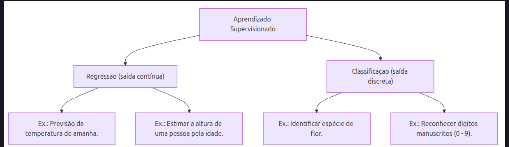

[[Aprendizado de Maquina Supervisionado Aulas]]
[[Aprendizado de Maquina Supervisionado Draw]]
# 5 semestre
%% so para ve se sobe %%
## Supervisionado Vs Não-Supervisionado

-> supervisionado ja temos as características <mark style="background:#fff88f">rotuladas</mark> informações previas das variáveis
-> NÃO-supervisionado não temos essas características <mark style="background:#fff88f">rotuladas </mark>

## AED (Analise Exploratória de Dados)

analise de uma fonte de dados
check list de informações para analisar levando sempre em consideração seu contexto

encontrar padrões, relações e tendencias e suas incosistencias entre os dados nos dados

### Tipos de Graficos

Dados <mark style="background:#9254de">Catergoricos</mark>: Barra e pizza
Dados  <mark style="background:#9254de">Numericos</mark>: Histograma e Linhas

 Medidas de centralidade e ou de dispersão

Centralidade: media, mediana e moda -> valor tipico ou central
dispersão:  desvio padrão, variancia e amplitude(intervalo) -> variedade do conjunto de dados

# Passo a passo de EAD

passo base: analise descritiva dos dados (frequencia, tendencia central, dispersao e distribuiçao)

Tipos de dados:
-> <mark style="background:#ff4d4f">univariados:</mark> apenas um atributo
-> <mark style="background:#ff4d4f">multivariados:</mark> dois ou mais atributos para compor o dado

Percentil: é o numero de partes em porcentagem o numero indicado pelo percentil

![[Pasted image 20260404103930.png]]

<- menores dados ========= maiores dados ->

devem esta ordenados de forma crescente

Caso do valor da posição não for inteira é feita a interpolação linear

![[Pasted image 20260404105623.png]]

### Desvio padrão

1° media
2° desvio => pega cada valor e subtrai da media
3° variância => soma todos os desvios ao quadrado  e divide pela quantidade de elementos
4° desvio padrão => é a raiz quadrada da variância

### Desvio médio absoluto => AAD

dispersão dos dados em relação a media mede a variabilidade doa variáveis

<mark style="background:#d4b106">mesmo que a variância so que não leva os valores ao quadrado</mark>

# <mark style="background:#40a9ff">Para pode medir mais de uma variavel (Multivariavel) => usamos a COVARIANCIA</mark>

para que as variaveis sejam independentes o grau de cov é zero
### exemplo do uso de cov

![[Pasted image 20260404145703.png]]

## Pre-processamento de dados

=> Redução de gastos e mais precisão no treinamento e na analise de padros de dados

    -> Filtros: 
        analisar informações que estão faltando 
        quais variáveis são pertinentes para analise (finalidade)
    -> Agrupar dados: expecificar os dados

- 1 eliminar dados que não agregam informações tão relevantes para analise
- 2 apenas pegar os mais relevantes para analise dos dados
## Comando py
```

.isnull() // => retorna quais colunas de dados tem elementos faltantes
.dropna(axis=0) //=> elimina as linhas que estao com os paramentros faltantes 
.dropna(axis=1) //=> elimina as colunas que estao com os paramentros faltantes 
.dropna(how='all') //=> elimina a linha se apenas se todos os parametros dele estiver faltando
.sample(n=) //=> n é o valor de elementos q seram imprimidos na tabela

```

## Integraçao de dados

=> problema de indentificaçao de entediade (Reorganizar uma das bases de dados para que fiquem corelacionadas)

- 1 organizar por indices

 ```
 
 SimpleImputer => serve para colocar nos valores q estão faltando um x valor apartir da estratagia q passada nele
  
 ```

## Dados desbalanceados => podem levar aos dados estarem invesados o que causa ao modelos de AM uma baixa capacidade de <mark style="background:#40a9ff">GENERALIZAÇÃO</mark>

## Dados inconsistentes

dados mal colocados ou dados incoerentes com analise logica

# <mark style="background:#ff4d4f"> => tanto para integrar dados quanto para inconsistência de dados</mark>

![[Pasted image 20260404161402.png]]

## Dados Redundantes

dados repetidos

## Dados com ruídos

dados que apresentam falhas nas medições =>
  - filtragem
  - Suavização
  - remover outlines

## Transformação de dados

mudança de escalas

![[Pasted image 20260404161836.png]]

Box-cox para indicar qual a melhor forma de transforma (priorizando a acurácia e a fidelidade dos dados)

para AM podemos usar basicamente StandardScaler

### Padronizar VS Normalizar

focam em redimensionar os dados para redução de custos 3

=> Normalização leva os dados a valores entre 0 e 1
=> Padronização leva os dados dos valores da media vai a 0 e o DP vai a 1 mas o restante não fica limitada a nenhum range

<mark style="background:#affad1">padronizar</mark> quando os dados seguem uma distribuição gaussiana para quando quero a PCA e quando a muitos outlines

<mark style="background:#fdbfff">normalizar</mark> quando os dados não seguem uma distribuição não gaussiana o algorítimo de analise requer q os dados fiquem em uma escala entre 0 e 1 evitar se ainda tiver outlines nos dados

# Reduzir dados

esse processo ganha eficiencia mais pode perder informaçoes mesmo com o metodo PCA que metiga essa perca pode aver perda das informaçoes originais

 mantem a variancia no maximo possivel mas mantem apenas os atributos mais relevantes os componentes principais sao os pontos com maxima variancia em espaço reduzido

# Regressão <mark style="background:#9254de">Linear</mark> VS <mark style="background:#9254de">Logística</mark>

## Regressão linear: para tarefaz onde a saida deve ser um valor continuo (mais alinhado com o AM Nao supervisionado)

    saida Y em de atravez de uma combinação linear das entradas X => devemos encontrar o valor que minimize o valor do erro (MSE)
    => formas de ajustar os paramentros do algoritmo
            OLS: minimos quadrados ordinarios: via algebra
            Gradiante descedente: forma interativa foca em minimizar o erro ajuste de parametro a parametro

## Regressão Logística: para tarefaz onde a saida deve ser uma classificação



**_underfitting_:** poucos dados nao (baixa visao do geral) mal treinado
**_overfitting_:** condicionado d+ (enviesado) treinado ate demais pouco generalista

-> geralmente usamos (70% treino e 30% testes)

# Flxuxo de como fazer as coisas em ML

- 1 importar os dados e explora-los: compreender sobre o que é  dataset, caracteristicas, distribuições e possviel falhas
- 2 pre-processamento dos dados: tratar as falhas dos dados (seguir os passos do notebook anterior)
- 3 treinar o modelo: (fit_transform -> com os dados ja normalizados ou padronizados a depender do modelo que estamos trabalhando)
- 4 realizar prediçõs: usar os dados de teste
- 5 avalisar o desempenho: usar a acuracy ou MSE (valor ao quadrado aqui)


```python

import numpy as np # para formulas matematicas

import matplotlib.pyplot as plt # para plotar o grafico

from sklearn.datasets import make_regression #os dados para o modelo

from sklearn.model_selection import train_test_split #Faz os split para parte de treino e parte de test de forma linear e balanceado dos dados

from sklearn.linear_model import LinearRegression #Escolha do modelo que sera usar para analise dos dados

```

muitas vezes o seed vem com o nome random_state comum usar em 42 para sempre termos os mesmo resultados pra o gráfico

=> lembrar sempre de seguir o passo a passo do fluxo de aprendizado de ML

# Interpolação VS Extrapolação

<mark style="background:#9254de">Interpolação: </mark>
	Previsão em intervalos com buracos para preencher => confiável ja que o modelo aprendeu padrões daquele intervalo
    Sua dois pontos faz uma media e acha um valor de y a partir de um x entrada
<mark style="background:#9254de">Extrapolação:  </mark>
	Previsão para dados fora do intervalo conhecido mais arriscado ja q o modelo n tem dados para se basear concretamente 

# Regressão Logística

usado para quando preciso q a saída seja uma categoria ou categorizar os dados

usa basicamente depois de achar o z da LINEAR aplica sigmoide achando assim o queremos

e dada pela probabilidade de esta o não esta  => classifica entre 0 e 1 para multiclasse podemos ter [0.66,0.24,0.10] depois de aplicar o softmax na saida

nesse tipo de modelo usamos a acurácia do valor no lugar da métrica de erro minimizado 


```python
from sklearn.datasets import make_classification # dataset

from sklearn.linear_model import LogisticRegression # modelo que sera usado

from sklearn.metrics import accuracy_score # para extrair a acuracia do processo
```

#### exemplo do uso da norm e padro

Na regressão logística a normalização não é obrigatória mas é recomenda para que tenhamos mais eficiência no treinamento e no plot => a padronização somente quando tiver a presença de muitos outlines 
	as vezes nesse tipo de modelo é preciso passar quantos quantos passos ele ira executar para fazer sua classificação.
=> para datasets com muitos atributos sempre fazer o PCA para reduzir suas dimensões

# oq saber ate aqui
> [!note] Conteudos para saber ate aqui
> - **Regressão** *vs* **Classificação**;
> - Dados de **treinamento** *vs* **teste**.
> - **Fit/treinamento do modelo**;
> - **Interpolação** *vs* **Extrapolação**;
> - **Underfitting** *vs* **Overfitting**;
> - **Fluxo de trabalho** do aprendizado de máquina.

# Métodos Baseados em Distância

usam a simliariedade ou dissimilariedade das amostras do dataset => classifica e regressao ja no NAO usamos para agrupar os dados (clusters) e detectar anomalias na amostra

Geralmente falamos do KNN baseados nos vizinhos mais procimos -> primeiro normalizamos e aplicamos a PCA
 - o KNN e chamado de algoritmo pregriso (Lazy) pq n tem uma etapa de aprendizado de fato
 - calculamos pontos medios para classificar os pontos e formar os grupos
 1-NN:

supervices de descisao: conjunto de ponto nesse caso o 1 vizinho mais proximo => assim como qualquer algotimo da familia do NN n apresenta nenhuma fase propriamente dita de treinamento calculando as coisas na hora sempre 

para:
	Classificação: o ponto q caiu mais proximo do meu elemento ja classificado, recebe a mesma classificacao => <mark style="background:#ff4d4f">moda</mark>
	Regresão: o valor de preditic sera o mesmo do valor do vizinho mais proximo do ponto q usamos para start => <mark style="background:#ff4d4f">media</mark>

##### <mark style="background:#40a9ff">O calulo pesado sempre e feito no momentoda enferencia </mark>
-> nao gasto com treinamento  